 

## Sobre mim

Sou estudante de **Análise e Desenvolvimento de Sistemas** pela Unicesumar e **Técnico em Desenvolvimento de Sistemas** pelo SENAI.

Tenho experiência prática com desenvolvimento de aplicações web, integração de APIs, bancos de dados SQL e construção de projetos próprios.

Meu principal foco de aprendizado hoje é **Python**, com interesse em desenvolvimento backend, automação de processos, integração de sistemas, infraestrutura e Indústria 4.0. Também tenho conhecimento e experiência de estudo em JavaScript, TypeScript, React, Node.js e tecnologias web.

Meu objetivo é desenvolver soluções reais, construir sistemas escaláveis e evoluir profissionalmente no mercado brasileiro e internacional.

## Atividade no GitHub

<!-- Dados dinâmicos de serviços externos. Podem atrasar ou ficar indisponíveis (limites de cada serviço). -->

 

## Tecnologias

A separação abaixo mostra o que já uso em projetos e o que ainda estou aprendendo.

<table>
<tr>
<td width="180"><b>Foco principal</b> Aprendizado ativo</td>
<td>
 
Python (linguagem principal de estudo), SQL, Git e GitHub
</td>
</tr>
<tr>
<td><b>Backend</b> Uso em projetos</td>
<td>
 
Node.js, Express, JavaScript, TypeScript e APIs REST
</td>
</tr>
<tr>
<td><b>Frontend</b> Uso em projetos</td>
<td>
 
HTML5, CSS3, JavaScript, TypeScript, React e Next.js
</td>
</tr>
<tr>
<td><b>Banco de dados</b> Uso em projetos</td>
<td>
 
SQL, MySQL e SQLite
</td>
</tr>
<tr>
<td><b>Ferramentas</b></td>
<td>
 
Git, GitHub, VS Code e Postman
</td>
</tr>
<tr>
<td><b>Hardware</b> Projeto SIMEQ</td>
<td>
 
Arduino e sensores (incluindo sensor de pressão)
</td>
</tr>
<tr>
<td><b>Em aprendizado</b></td>
<td>
 
FastAPI, PostgreSQL e Linux em estudo. Java em nível de fundamentos.
</td>
</tr>
</table>

## Foco atual de aprendizado

- **Python** como linguagem principal de estudo.
- **Backend:** construção de APIs e integração entre sistemas (FastAPI em estudo).
- **Banco de dados:** aprofundamento em SQL e PostgreSQL.
- **Linux** e fundamentos de infraestrutura.
- **Software e hardware:** Arduino e sensores, a partir do projeto SIMEQ.
- **Próximos passos:** automação industrial, Internet das Coisas (IoT), MQTT, redes industriais e integração de sistemas.

## Projetos em destaque

<!-- Quando o SIMEQ tiver repositório ou demonstração, envolva a imagem abaixo com: <a href="URL_DO_PROJETO"> ... </a> -->

## AI & Continuous Learning

Uso inteligência artificial como ferramenta de apoio ao aprendizado e ao desenvolvimento, sempre revisando e entendendo o que é produzido.

Principais usos no meu dia a dia:

- Estudar programação.
- Entender documentação.
- Investigar erros.
- Revisar código.
- Explorar soluções técnicas.
- Acelerar o aprendizado.

## Formação

| Curso | Instituição | Status |
|---|---|---|
| Análise e Desenvolvimento de Sistemas | Unicesumar | Em andamento, conclusão prevista em 2028 |
| Técnico em Desenvolvimento de Sistemas | SENAI | Em andamento, conclusão prevista em 2027 |

A formação em desenvolvimento de software caminha junto com o interesse em tecnologia industrial.

## Objetivos profissionais

- Atuar com desenvolvimento backend e automação de processos.
- Construir sistemas escaláveis que resolvam problemas reais.
- Conectar software e ambiente industrial (Indústria 4.0, IoT, integração de sistemas).
- Evoluir tecnicamente e construir carreira no Brasil e no exterior.

## Contato

Camaçari, Bahia, Brasil
